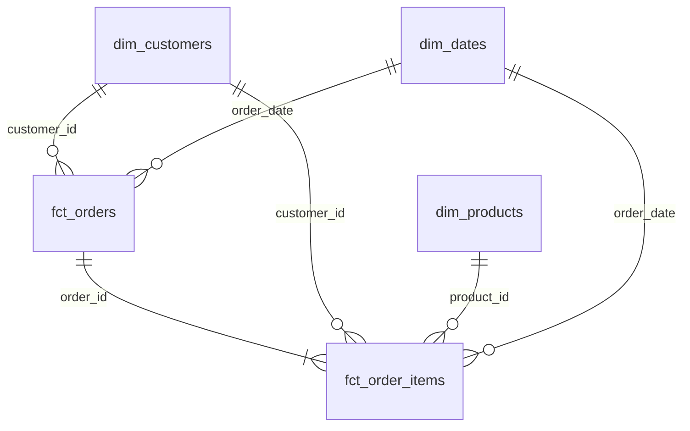
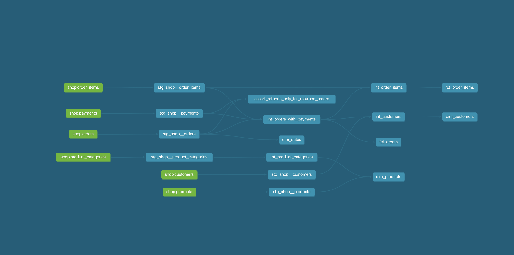

## Модель данных

| Витрина | Одна строка | Бизнес-вопрос |
|---|---|---|
| `fct_orders` | Заказ | Сколько заказов подтверждено и какую выручку они принесли за период? |
| `fct_order_items` | Товар в заказе | Какие товары, бренды и категории приносят выручку? |
| `dim_customers` | Клиент | Какие каналы привлекают покупателей и когда клиенты совершают первую покупку? |
| `dim_products` | Товар | К какому бренду и ветке категорий относится товар? |
| `dim_dates` | Календарный день | Как меняются продажи по месяцам, кварталам и дням недели? |

### Хранение в Greenplum

| Витрина | Распределение | Хранение | Обоснование |
|---|---|---|---|
| `fct_orders` | `DISTRIBUTED BY (order_id)` | Строковое | Заказ и его позиции распределяются по одному ключу, что помогает соединять их быстро разбивать на сегменты. В целом, у нас зернистость одна строка = один заказ, поэтому оптимальнее для анализа использовать стороковое|
| `fct_order_items` | `DISTRIBUTED BY (order_id)` | Колоночное | Позиции соединяются с заказами по `order_id`. Колоночное хранение удобно в данном случае, потому что, если мы захотим посчитать всю корзину клиента, то мы просто агрегируем по группе и считаем колонку, а если в целом захотим посмотреть, сколько за все время принес клиент, то будем группировать по кастомеру и считать колонку, в общем это очень сильно ускоряет процесс таких подсчетов|
| `dim_customers` | `DISTRIBUTED REPLICATED` | Строковое | Тк справочник клиентов не особо большой (13 строк), то можно в каждый сегмент закинуть копию|
| `dim_products` | `DISTRIBUTED REPLICATED` | Строковое | Каталог товаров доступен на каждом сегменте при соединении с позициями заказов, опять же потому что небольшая таблица можно позволить себе такое расточительство |
| `dim_dates` | `DISTRIBUTED REPLICATED` | Строковое | Календарь доступен на каждом сегменте при соединении фактов по дате |

В `raw.orders` и `raw.order_items`  используется распределение по `order_id`, логично, что если пойти от противного и не брать order_id, то при распределении данным попапуд в разные сегменты и потом гринпалм будет заниматься пересылкой строк по сегментам, следовательно нужно сегментировать по order_id

### Warn котороый выявил один из тестов

Заказ `113` стоит 200 рублей. В исходных данных по нему есть две успешные оплаты по 200 рублей. Сумма списаний составляет 400 рублей, переплата 200 рублей, выявил тест `assert_confirmed_orders_not_overpaid`, в логах появилась надписаь `warn=1`

### Граф зависимостей dbt

